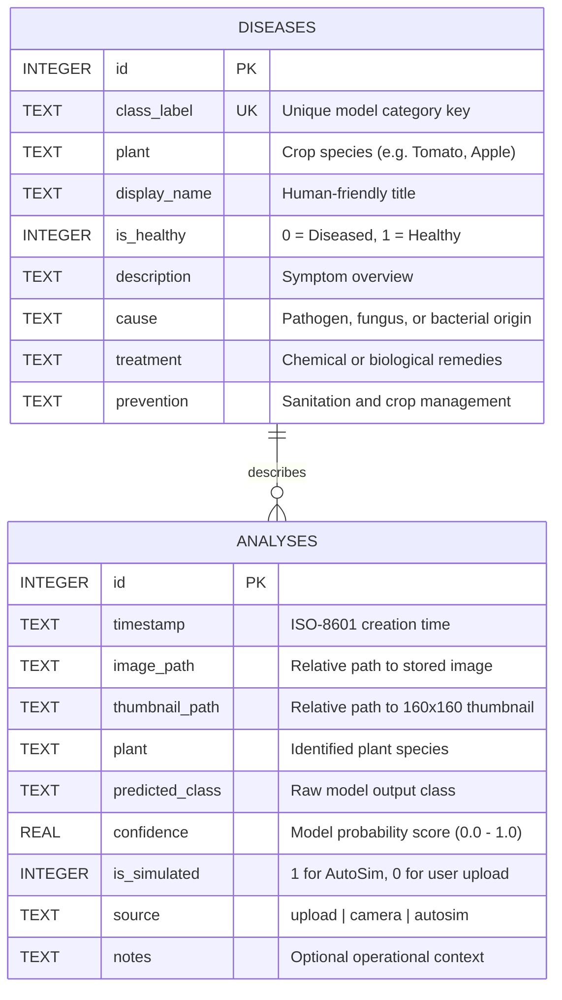

# Database Documentation

This document describes the embedded **SQLite** database architecture, entity relationships, tables, and automated seeding mechanism used by the Plant Health Detection App.

---

## Architecture Overview

- **Engine**: SQLite 3 (single-file serverless relational database).
- **File Location**: `app/db/plant_health.db`.
- **Initialization**: Automatically created and seeded on application startup by `app/backend/database.py`.
- **Integrity**: Enforces primary key auto-incrementation, timestamping, unique class constraints, and indexed lookups.

---

## Entity Relationship (ER) Diagram



---

## Table Definitions

### 1. `diseases` Table

Stores agronomic profiles, pathogens, biological causes, and care actions for all crop conditions the neural network can output.

| Column | Data Type | Constraints | Description |
|---|---|---|---|
| `id` | `INTEGER` | `PRIMARY KEY AUTOINCREMENT` | Unique disease identifier |
| `class_label` | `TEXT` | `UNIQUE NOT NULL` | Exact raw output string from TFLite classifier |
| `plant` | `TEXT` | `NOT NULL` | Common crop name (e.g., Tomato, Corn) |
| `display_name` | `TEXT` | `NOT NULL` | Clean human-readable disease name |
| `is_healthy` | `INTEGER` | `DEFAULT 0` | Flag (1 if healthy foliage, 0 if disease) |
| `description` | `TEXT` | `NOT NULL` | Visual symptoms and disease development |
| `cause` | `TEXT` | `NOT NULL` | Specific fungal, bacterial, or viral pathogen |
| `treatment` | `TEXT` | `NOT NULL` | Direct management, fungicides, pruning advice |
| `prevention` | `TEXT` | `NOT NULL` | Crop rotation, watering methods, resistant seeds |

#### Sample Row (`diseases`)

```sql
INSERT INTO diseases (
    class_label, plant, display_name, is_healthy,
    description, cause, treatment, prevention
) VALUES (
    'Tomato___Early_blight',
    'Tomato',
    'Early Blight',
    0,
    'Concentric rings forming a distinctive target board pattern within brown, dying patches on older lower leaves. Surrounding tissue turns yellow.',
    'Fungus Alternaria linariae. Overwinters in old tomato vines and weeds; spores splash onto lower foliage from the soil.',
    'Prune away lower yellowing and infected leaves. Apply protective fungicides such as chlorothalonil, copper, or bio-fungicides every 7–10 days.',
    'Mulch the soil heavily around tomato plants to stop soil splash. Prune lower suckers up to 12 inches from ground level to improve airflow.'
);
```

---

### 2. `analyses` Table

Records every leaf analysis processed by the system, whether submitted via file upload, in-app live camera capture, native mobile camera, or the AutoSim button.

| Column | Data Type | Constraints | Description |
|---|---|---|---|
| `id` | `INTEGER` | `PRIMARY KEY AUTOINCREMENT` | Unique analysis scan identifier |
| `timestamp` | `TEXT` | `NOT NULL` | ISO-8601 format timestamp (e.g. `2026-11-25T22:38:15`) |
| `image_path` | `TEXT` | `NOT NULL` | Path to stored image (e.g. `/uploads/scan_a1b2c3d4.jpg`) |
| `thumbnail_path` | `TEXT` | `NULL` | Path to square thumbnail (e.g. `/uploads/thumbs/thumb_a1b2c3d4.jpg`) |
| `plant` | `TEXT` | `NOT NULL` | Diagnosed plant species |
| `predicted_class`| `TEXT` | `NOT NULL` | Winning classifier class label |
| `confidence` | `REAL` | `NOT NULL` | Probability score between 0.0000 and 1.0000 |
| `is_simulated` | `INTEGER` | `DEFAULT 0` | 1 if produced by AutoSim; 0 if user captured |
| `source` | `TEXT` | `DEFAULT 'upload'` | Input origin: `'upload'`, `'camera'`, or `'autosim'` |
| `notes` | `TEXT` | `NULL` | Context notes (e.g. sample image filename) |

#### Sample Row (`analyses`)

| id | timestamp | image_path | thumbnail_path | plant | predicted_class | confidence | is_simulated | source | notes |
|---|---|---|---|---|---|---|---|---|---|
| 1 | 2026-11-25T22:38:15 | /uploads/scan_9f4e2a.jpg | /uploads/thumbs/thumb_9f4e2a.jpg | Apple | Apple___Apple_scab | 0.9802 | 1 | autosim | AutoSim using sample: apple_scab.jpg |

---

## Automated Database Seeding

The application implements zero-setup seeding:

1. When the server launches, FastAPI's `lifespan` handler calls `init_db()`.
2. Tables `analyses` and `diseases` are created with `IF NOT EXISTS`.
3. An optimization index is verified on `analyses.timestamp DESC` and `diseases.class_label`.
4. The database queries `SELECT COUNT(*) FROM diseases`.
5. If the table is empty or missing entries, it iterates through the comprehensive knowledge dictionary in `app/backend/seed_data.py` (which contains rich agronomic profiles for all 38 PlantVillage classes, plus Banana, Cacao, and Coffee from the base repo) and inserts them using `ON CONFLICT(class_label) DO UPDATE`.
