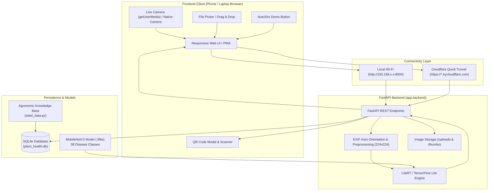

# How It Works

This document details the system architecture, machine learning inference pipeline, local vs. online networking, browser security considerations, and QR code integration.

---

## System Architecture

---

## Request Flow: Photo to Diagnosis

1. **Image Ingestion**:
   - The user captures an image via the in-app live camera viewfinder, selects a photo from the gallery, drops a file on desktop, or triggers **AutoSim**.
2. **Pre-Flight Validation**:
   - Client-side checks ensure the file is an image under 15 MB.
3. **Transport to Backend**:
   - Sent via `POST /api/analyze` (multipart/form-data) over the active connection (LAN or Cloudflare Tunnel).
4. **EXIF Normalization & Preprocessing**:
   - `ImageOps.exif_transpose` corrects orientation tags from smartphones held vertically or upside-down.
   - Resized using bilinear interpolation to `(224, 224, 3)`.
   - Converted to float32 normalized into range `[0.0, 1.0]` by dividing pixel values by `255.0`.
5. **TensorFlow Lite Inference**:
   - Invokes the quantized MobileNetV2 interpreter via CPU XNNPACK delegate.
   - Computes output probabilities across all 38 classes.
6. **Confidence Thresholding & Diagnosis**:
   - Highest probability category selected.
   - If confidence $< 60\%$ (`CONFIDENCE_THRESHOLD`), an explicit `is_low_confidence = true` flag is attached, instructing the UI to display a cautionary warning rather than giving false certainty.
7. **Persistence & Advice Retrieval**:
   - Original image and a 160x160 thumbnail are stored in `app/uploads/`.
   - Record inserted into SQLite `analyses` table.
   - Rich agronomic advice (description, cause, treatment, prevention) retrieved from `diseases` table.
8. **Client Rendering**:
   - Real-time display of plant species, condition, confidence gauge, advice cards, and alternative predictions.

---

## Machine Learning Model Specifications

| Parameter | Specification |
|---|---|
| **Architecture** | MobileNetV2 (Inverted Residuals & Linear Bottlenecks) |
| **Format** | TensorFlow Lite (`.tflite`) |
| **Model Size** | 11.57 MB |
| **Input Tensor** | `[1, 224, 224, 3]`, `float32`, RGB order |
| **Pixel Range** | Normalized to `[0.0, 1.0]` |
| **Output Tensor** | `[1, 38]`, `float32` (probability distribution) |
| **Training Dataset** | PlantVillage benchmark dataset (54,306 images across 14 crops) |
| **Inference Latency** | ~35–50 ms on a standard modern CPU |
| **License** | Open Source (MIT License) |

### Supported Crops & Conditions (38 Classes)

1. **Apple**: Apple Scab, Black Rot, Cedar Apple Rust, Healthy
2. **Blueberry**: Healthy
3. **Cherry**: Powdery Mildew, Healthy
4. **Corn (Maize)**: Gray Leaf Spot, Common Rust, Northern Leaf Blight, Healthy
5. **Grape**: Black Rot, Esca (Black Measles), Leaf Blight (Isariopsis), Healthy
6. **Orange**: Citrus Greening (Huanglongbing)
7. **Peach**: Bacterial Spot, Healthy
8. **Pepper (Bell)**: Bacterial Spot, Healthy
9. **Potato**: Early Blight, Late Blight, Healthy
10. **Raspberry**: Healthy
11. **Soybean**: Healthy
12. **Squash**: Powdery Mildew
13. **Strawberry**: Leaf Scorch, Healthy
14. **Tomato**: Bacterial Spot, Early Blight, Late Blight, Leaf Mold, Septoria Leaf Spot, Two-Spotted Spider Mites, Target Spot, Yellow Leaf Curl Virus, Mosaic Virus, Healthy

---

## Local vs. Online Mode

### Local Mode (`1_START_LOCAL.bat`)
- Binds to `0.0.0.0:8000`.
- Interrogates network interfaces for the primary IPv4 gateway to find your LAN IP (e.g., `192.168.1.15`).
- Fast, zero internet data usage, fully private on your Wi-Fi router.
- *Browser Constraint*: Because plain HTTP on local IP is an unencrypted origin, modern mobile browsers block `navigator.mediaDevices.getUserMedia`. The app detects `window.isSecureContext === false` and seamlessly routes the camera button to native mobile camera capture (`<input type="file" accept="image/*" capture="environment">`).

### Online Mode (`2_START_ONLINE.bat`)
- Binds server to `127.0.0.1:8000`.
- Launches `cloudflared.exe` to create an ephemeral Cloudflare Quick Tunnel.
- Generates an encrypted `https://*.trycloudflare.com` URL accessible anywhere over cellular 4G/5G or remote Wi-Fi.
- Free, requires no account, and requires no port-forwarding on your home router.
- Because it runs over genuine HTTPS, in-app live camera streaming and progressive web app service workers function without restrictions on any mobile device.

---

## QR Code Generation

1. When the launcher runs, it writes the active URL to `app/runtime/connection.json`.
2. The frontend queries `GET /api/connection-info`.
3. The UI renders a scannable QR code using the locally bundled `vendor/qrcode.min.js` (zero CDN dependencies).
4. If client-side JavaScript execution fails or is disabled, the frontend falls back directly to the backend SVG QR generator (`GET /api/qr.svg`).
5. Scanning the QR code instantly opens the application on any mobile phone.
